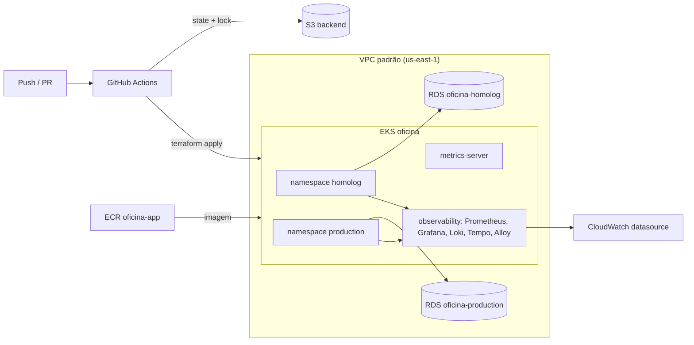

[PDF de entrega ao Portal - preliminar](output/pdf/fiap-fase3-entrega-portal.pdf)

[Fase 3: comece aqui - Postman, massas, PDFs, seed e demonstração](docs/fase3/COMECE-AQUI.md)

# oficina-infra-k8s

Infraestrutura Kubernetes da **Oficina Mecânica** (FIAP 16SOAT — Tech Challenge Fase 3), provisionada com
Terraform: cluster **Amazon EKS** com node group escalável, **ECR** para a imagem da aplicação e **metrics-server**
para o HPA, e um **API Gateway** por ambiente como porta de entrada da API.

Operação, recuperação e histórico do Learner Lab: [docs/LEARNER-LAB-OPERACAO.md](docs/LEARNER-LAB-OPERACAO.md).

## Tecnologias

- Terraform `>= 1.10` e provider AWS `~> 5.80`
- Amazon EKS (Kubernetes 1.34), node group `t3.medium` (mín. 2, máx. 4)
- Amazon ECR com scan on push e política de retenção
- Add-on `metrics-server` do EKS (necessário para o HPA)
- Amazon API Gateway (HTTP API) com log de acesso em JSON no CloudWatch
- State remoto em S3 com lock nativo (`use_lockfile`)
- GitHub Actions para validação, plan e apply

## Branches e ambientes

| Branch | Função |
|---|---|
| `main` | Integração. Protegida: merge somente via Pull Request. Em PR roda `fmt`, `validate` e `plan`. |
| `homolog` | Deploy automático (`terraform apply`) da infraestrutura em homologação. |
| `production` | Deploy automático (`terraform apply`) da infraestrutura em produção. |

### Um cluster, dois ambientes

Para reduzir custo no Learner Lab (cada cluster EKS cobra por hora), existe **um único cluster** compartilhado.
Homologação e produção são isolados por **namespaces** (`homolog` e `production`), criados pelos manifests do
repositório `oficina-app`, e por **bancos RDS separados** (`oficina-infra-db`). Por isso este repositório tem um
único state (`oficina-infra-k8s/terraform.tfstate`) e os pushes em `homolog` e `production` aplicam a mesma
configuração: a promoção entre branches funciona como esteira de aprovação da mudança de infraestrutura.

## Recursos criados

| Recurso | Descrição |
|---|---|
| `aws_eks_cluster` | Cluster `oficina`, na VPC padrão (a mesma do RDS), role `LabRole`. |
| `aws_eks_node_group` | Nós `t3.medium`, mínimo 2 e máximo 4. |
| `aws_eks_addon` (metrics-server) | Métricas de CPU/memória para o HPA. |
| `aws_subnet.gateway_private` + `aws_route_table.gateway_private` | Duas subnets sem rota para Internet para os NLBs internos e o VPC Link, sem alterar as subnets públicas já usadas pelo node group. |
| `aws_apigatewayv2_vpc_link` + security group | Caminho privado do API Gateway para listeners NLB dentro da VPC. |
| `aws_ecr_repository` | `oficina-app`, mantém as 15 imagens mais recentes. |
| `aws_apigatewayv2_api` | `oficina-homolog` e `oficina-production`: HTTP API, uma por ambiente. |
| `aws_apigatewayv2_stage` | Estágio `$default` com auto deploy, throttling e log de acesso em JSON. |
| `aws_cloudwatch_log_group` | `/aws/apigateway/oficina-<ambiente>`, retenção de 7 dias. |
| `aws_apigatewayv2_integration` + rotas | Proxy privado via VPC Link para NLB interno, com rota curinga protegida e exceções públicas enumeradas por método e caminho. |
| `aws_apigatewayv2_authorizer` + `aws_lambda_permission` | Authorizer Lambda `REQUEST` (payload 2.0, resposta simples, sem cache) e permissão de invocação por ambiente. |

## Observabilidade do cluster

A stack compartilhada fica em [`observability/`](observability/README.md), no namespace `observability`.
Ela inclui kube-prometheus-stack, Loki, Tempo, Alloy, Blackbox Exporter, regras iniciais e dashboard
Kubernetes. Sua instalação é um workflow Helm manual e serializado, separado do Terraform para não
inicializar provider Kubernetes durante a criação do EKS. O stack serve os namespaces `homolog` e
`production`; não há releases duplicadas por ambiente.

Antes de aplicar, confirmar StorageClass/EBS CSI, capacidade disponível, acesso read-only do Grafana
ao CloudWatch e secret `GRAFANA_ADMIN_PASSWORD` nos GitHub Environments. O Alertmanager ainda não tem
destinatários/canal configurados. Os PVCs locais e instâncias únicas atendem a uma demonstração, não
alta disponibilidade.

Decisões específicas do AWS Academy / Learner Lab: usa a role existente `LabRole` (cluster e nós), não cria IAM,
usa subnets públicas da VPC padrão (sem NAT Gateway) e restringe o cluster às AZs `us-east-1a/b/c`
(`us-east-1e` não suporta o control plane do EKS).



## API Gateway

É a única entrada pública planejada para a aplicação. O Gateway usa VPC Link para listeners de NLB interno; a rota curinga passa pelo Lambda Authorizer antes do encaminhamento ao cluster:

- `POST /v1/auth/customer` vai para a Lambda de autenticação por CPF, que emite o JWT. A rota é criada
  pelo repositório `oficina-lambda-auth`, que usa o id do gateway do seu ambiente (output `api_gateway_ids`).
- Sem Authorizer: `POST /v1/auth/login`, `POST /v1/worker/login`, links assinados de acompanhamento e decisão de orçamento e endpoints de health existentes.
- Com Authorizer: `ANY /` e `ANY /{proxy+}`. O Quarkus continua aplicando RBAC e isolamento das OS do cliente.
- OpenAPI e Swagger ficam públicos em `homolog` por padrão, usando rotas explícitas no Terraform (`/q/openapi`, `/q/swagger-ui` e os assets). `production` continua sem essas exceções. Publicar a documentação não remove o Authorizer das operações da API.
- Grafana será exposto apenas em `homolog`, em `/observability`, com login próprio obrigatório. Prometheus, Alertmanager, Loki, Tempo e receiver OTLP permanecem sem rota pública.
- O proxy define `overwrite:path = $request.path` para preservar o caminho completo; query string, corpo e headers seguem pela integração HTTP proxy.
- Os access logs usam `routeKey` (com parâmetros de rota mascarados) e não registram `$context.path`, que incluiria tokens assinados de acompanhamento ou orçamento.

O ARN do listener NLB interno e o ARN do Authorizer não são fixados no código. Os workflows publicam contratos sem segredos no bucket S3 usado pelo backend Terraform:

```text
oficina/config/v1/<homolog|production>/upstream.json
oficina/config/v1/<homolog|production>/authorizer.json
oficina/config/v1/homolog/grafana.json
```

O contrato `upstream.json` inclui `upstream_url`, `integration_listener_arn` e contexto de ambiente/conta/região. `authorizer.json` contém `lambda_arn`. O contrato opcional `grafana.json` contém `listener_arn` e habilita a rota do Grafana somente depois que o Service interno tem target saudável. Os contratos do ambiente solicitado e o SHA do serviço que iniciou a chamada são validados; ausência de contrato para ambiente já provisionado bloqueia a reconciliação. Um contrato de Gateway antigo pode omitir `integration_listener_arn` durante a etapa de migração; nesse caso a integração legada é preservada até o deploy da aplicação publicar o listener privado.

Após a reconciliação em `homolog`, o workflow reutilizável executa `scripts/api-gateway-authorizer-smoke-test.sh` contra a URL atual do Gateway. Nos Environments `homolog` dos repositórios que chamam esse workflow (`oficina-lambda-auth` e `oficina-app`), configure o secret `AUTHORIZER_TEST_CUSTOMER_CPF` com um cliente sintético e ativo. O teste não imprime CPF nem JWT; o resumo registra somente cenário, código HTTP e request ID. Esse cliente deve permanecer ativo para as execuções seguintes.

### Bootstrap e promoção entre ambientes

1. Preserve o state existente. `AWS_REGION` e `TF_STATE_BUCKET` vêm das variables da Organization; homolog usa os secrets Organization `HOMOLOG_AWS_*`, restritos aos quatro repositórios, e production mantém `AWS_*` no Environment. Não remova recursos do state para contornar uma validação de contrato.
2. Publique o Authorizer de homologação pela pipeline Lambda. Se o upstream ainda não existir, publique o contrato de Authorizer e deixe a integração marcada como pendente; não chame a reconciliação ainda.
3. Aplique a infraestrutura privada em homologação. Depois, implante a aplicação para criar o NLB interno, publicar `integration_listener_arn` e reconciliar o Gateway; só então o workflow remove o Service público legado.
4. Rode `workflow_dispatch` de observabilidade no branch `homolog`; o workflow instala o stack, publica o listener privado do Grafana e reconcilia `/observability` depois de validar target saudável e a tela de login.
5. Produção pode permanecer sem contratos enquanto não tiver rotas no state. A rota pública do Grafana fica apenas em homolog; produção exige seus contratos de aplicação e Authorizer quando for promovida.

O workflow lê `terraform state list` antes de montar os mapas. Se o state mudar entre essa leitura e o plano, `prevent_destroy` bloqueia qualquer tentativa de remover Authorizer, integração ou rota protegida. O plano de reconciliação segue limitado aos recursos de roteamento do ambiente solicitado.

O endereço do Service é um NLB interno criado pelo Kubernetes, não pelo Terraform. A aplicação descobre o
hostname após readiness, consulta o listener AWS e publica `upstream.json`; não mantenha cópias do DNS ou ARN no repositório.
Para conferência manual:

```shell
kubectl get svc oficina-mecanica-gateway -n homolog -o jsonpath='{.status.loadBalancer.ingress[0].hostname}'
```

As URLs públicas saem dos outputs `api_gateway_urls`.

## Pré-requisitos

Os mesmos do `oficina-infra-db`:

- Bucket S3 do state; variables Organization `TF_STATE_BUCKET` e `AWS_REGION` (podem ser sobrescritas por variables de Environment).
- Secrets Organization `HOMOLOG_AWS_ACCESS_KEY_ID`, `HOMOLOG_AWS_SECRET_ACCESS_KEY` e `HOMOLOG_AWS_SESSION_TOKEN`, com acesso selecionado somente a oficina-app, oficina-lambda-auth e oficina-infra-k8s, conforme o escopo desta homologação. O pipeline do banco requer conferência separada das próprias credenciais; não ampliar automaticamente o acesso das secrets da organização. Production mantém `AWS_*` no Environment.

## Execução local

```shell
export AWS_ACCESS_KEY_ID=... AWS_SECRET_ACCESS_KEY=... AWS_SESSION_TOKEN=...

terraform init \
  -backend-config="bucket=<bucket>" \
  -backend-config="key=oficina-infra-k8s/terraform.tfstate" \
  -backend-config="region=us-east-1"
terraform plan
```

Depois do apply, configure o `kubectl`:

```shell
aws eks update-kubeconfig --name oficina --region us-east-1
kubectl get nodes
kubectl top nodes
```

## Pipelines

`.github/workflows/terraform.yml`:

- **Pull Request**: `terraform fmt -check` e `validate`, sem credenciais AWS ou state remoto.
- **Push ou execução manual em `homolog`/`production`**: lê o state, valida os contratos exigidos para os ambientes já provisionados, cria um plano salvo e aplica esse plano no state compartilhado. O workflow manual serve para recuperação após renovar as credenciais do Learner Lab.
- `.github/workflows/reconcile.yml`: workflow reutilizável chamado pelos repositórios da aplicação e da Lambda. Lê os contratos obrigatórios do ambiente solicitado e preserva o par de outro ambiente quando já houver recursos no state; usa o lock S3 e bloqueia qualquer plano que altere EKS, ECR ou roteamento de ambiente não solicitado.

O bucket `TF_STATE_BUCKET` precisa manter acesso restrito, criptografia e versionamento. Ele contém o state e os contratos `oficina/config/v1/`; os contratos não contêm secrets. Planos e state não são publicados como artifact ou summary. A concorrência do GitHub é limitada ao repositório chamador. O lock S3 coordena as operações Terraform; a rotina de convergência espera pelo lock, valida novamente os contratos e recalcula planos desatualizados. Isso não torna os contratos S3 e o state uma transação atômica.

A criação do cluster leva cerca de 15 minutos.

## Próximos passos

Fechar as lacunas da [matriz da Fase 3](docs/fase3/VALIDACAO.md): métricas HTTP/histogramas,
indicadores de negócio, traces correlacionados, alertas de falha de OS, links dos READMEs e vídeo.
Aplicação, Lambda e stack já possuem implementação e deploy em homolog; produção ainda
precisa de evidência de execução e decisão de promoção.

## Documentação da Fase 3

[Índice arquitetural](docs/fase3/README.md), [componentes](docs/fase3/ARQUITETURA.md),
[sequências](docs/fase3/SEQUENCIAS.md), [modelo relacional](docs/fase3/MODELO-DE-DADOS.md),
[RFCs/ADRs](docs/fase3/README.md#decisões), [matriz de atendimento](docs/fase3/VALIDACAO.md)
e [roteiro do vídeo](docs/fase3/ROTEIRO-VIDEO.md).

Homologação: [Swagger](https://dcs5hfax0e.execute-api.us-east-1.amazonaws.com/q/swagger-ui/),
[OpenAPI](https://dcs5hfax0e.execute-api.us-east-1.amazonaws.com/q/openapi?format=json)
e [Grafana](https://dcs5hfax0e.execute-api.us-east-1.amazonaws.com/observability/).
Os endpoints dependem da sessão/recursos do Learner Lab. O vídeo e a submissão final ainda
estão pendentes; a matriz registra o que foi efetivamente validado.
