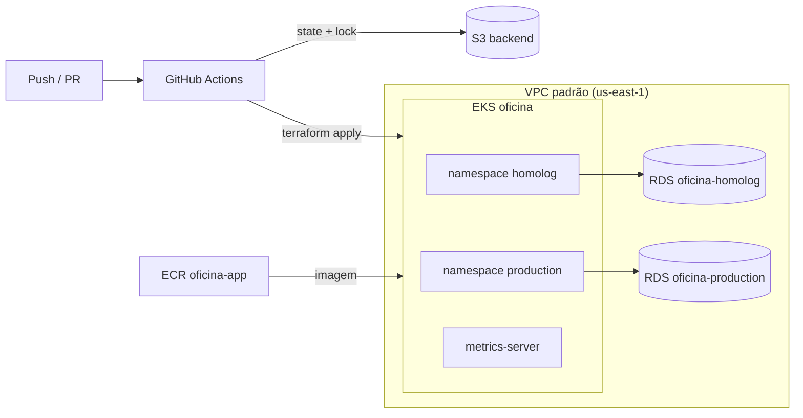

# oficina-infra-k8s

Infraestrutura Kubernetes da **Oficina Mecânica** (FIAP 16SOAT — Tech Challenge Fase 3), provisionada com
Terraform: cluster **Amazon EKS** com node group escalável, **ECR** para a imagem da aplicação e **metrics-server**
para o HPA, e um **API Gateway** por ambiente como porta de entrada da API.

## Tecnologias

- Terraform `>= 1.10` e provider AWS `~> 5.80`
- Amazon EKS (Kubernetes 1.34), node group `t3.medium` (mín. 2, máx. 4)
- Amazon ECR com scan on push e política de retenção
- Add-on `metrics-server` do EKS (necessário para o HPA)
- Amazon API Gateway (HTTP API) com log de acesso em JSON no CloudWatch
- State remoto em S3 com lock nativo (`use_lockfile`)
- GitHub Actions para validação, plan e apply

## Branches e ambientes

| Branch | Função |
|---|---|
| `main` | Integração. Protegida: merge somente via Pull Request. Em PR roda `fmt`, `validate` e `plan`. |
| `homolog` | Deploy automático (`terraform apply`) da infraestrutura em homologação. |
| `production` | Deploy automático (`terraform apply`) da infraestrutura em produção. |

### Um cluster, dois ambientes

Para reduzir custo no Learner Lab (cada cluster EKS cobra por hora), existe **um único cluster** compartilhado.
Homologação e produção são isolados por **namespaces** (`homolog` e `production`), criados pelos manifests do
repositório `oficina-app`, e por **bancos RDS separados** (`oficina-infra-db`). Por isso este repositório tem um
único state (`oficina-infra-k8s/terraform.tfstate`) e os pushes em `homolog` e `production` aplicam a mesma
configuração: a promoção entre branches funciona como esteira de aprovação da mudança de infraestrutura.

## Recursos criados

| Recurso | Descrição |
|---|---|
| `aws_eks_cluster` | Cluster `oficina`, na VPC padrão (a mesma do RDS), role `LabRole`. |
| `aws_eks_node_group` | Nós `t3.medium`, mínimo 2 e máximo 4. |
| `aws_eks_addon` (metrics-server) | Métricas de CPU/memória para o HPA. |
| `aws_ecr_repository` | `oficina-app`, mantém as 15 imagens mais recentes. |
| `aws_apigatewayv2_api` | `oficina-homolog` e `oficina-production`: HTTP API, uma por ambiente. |
| `aws_apigatewayv2_stage` | Estágio `$default` com auto deploy, throttling e log de acesso em JSON. |
| `aws_cloudwatch_log_group` | `/aws/apigateway/oficina-<ambiente>`, retenção de 7 dias. |
| `aws_apigatewayv2_integration` + `aws_apigatewayv2_route` | Proxy `ANY /{proxy+}` para o Service da aplicação; só existe para o ambiente com endereço em `app_upstream_urls`. |

Decisões específicas do AWS Academy / Learner Lab: usa a role existente `LabRole` (cluster e nós), não cria IAM,
usa subnets públicas da VPC padrão (sem NAT Gateway) e restringe o cluster às AZs `us-east-1a/b/c`
(`us-east-1e` não suporta o control plane do EKS).



## API Gateway

É a porta de entrada pública da API. O cliente chama o gateway, e ele decide para onde cada rota vai:

- `POST /v1/auth/customer` vai para a Lambda de autenticação por CPF, que emite o JWT. A rota é criada
  pelo repositório `oficina-lambda-auth`, que usa o id do gateway do seu ambiente (output `api_gateway_ids`).
- Todo o resto (`ANY /{proxy+}`) vai para o Service da aplicação no cluster.

O endereço do Service é um ELB criado pelo Kubernetes, não pelo Terraform, então ele é informado em
`terraform.tfvars` (`app_upstream_urls`). Um ambiente sem endereço ali fica com o gateway criado, mas sem
o proxy. Para descobrir o endereço:

```shell
kubectl get svc oficina-mecanica -n homolog -o jsonpath='{.status.loadBalancer.ingress[0].hostname}'
```

As URLs públicas saem dos outputs `api_gateway_urls`.

## Pré-requisitos

Os mesmos do `oficina-infra-db`:

- Bucket S3 do state e variável `TF_STATE_BUCKET`; variável `AWS_REGION`.
- Secrets `AWS_ACCESS_KEY_ID`, `AWS_SECRET_ACCESS_KEY` e `AWS_SESSION_TOKEN` (Learner Lab, expiram em ~4h).

## Execução local

```shell
export AWS_ACCESS_KEY_ID=... AWS_SECRET_ACCESS_KEY=... AWS_SESSION_TOKEN=...

terraform init \
  -backend-config="bucket=<bucket>" \
  -backend-config="key=oficina-infra-k8s/terraform.tfstate" \
  -backend-config="region=us-east-1"
terraform plan
```

Depois do apply, configure o `kubectl`:

```shell
aws eks update-kubeconfig --name oficina --region us-east-1
kubectl get nodes
kubectl top nodes
```

## Pipeline

`.github/workflows/terraform.yml`:

- **Pull Request**: `terraform fmt -check`, `validate` e `plan`.
- **Push em `homolog` ou `production`**: `terraform apply` (execuções serializadas, pois compartilham o state).

A criação do cluster leva cerca de 15 minutos.

## Próximos passos

- `oficina-app`: Dockerfile, manifests (Deployment, Service `LoadBalancer` com NLB, HPA) e pipeline de push no ECR e deploy.
- `oficina-lambda-auth`: Terraform e pipeline da Lambda, registrando `POST /v1/auth/customer` no gateway.
- Decidir com o time se o cluster passa a ser privado (Ingress, ou NLB interno com VPC Link) em vez de expor o ELB.
