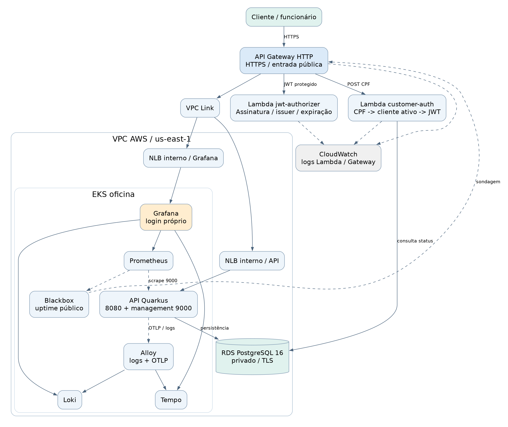

# Arquitetura e componentes

## Escopo e estado

A solução organiza atendimento, clientes, veículos, ordens de serviço, orçamentos,
serviços e peças. O ambiente confirmado é homologação em AWS us-east-1 no Learner Lab.
Os quatro repositórios possuem workflows e regras de PR em main. Os workflows de produção
estão definidos; não foi encontrada execução de produção nesta revisão.

## Caminhos de execução

| Origem | Destino | Contrato e responsabilidade |
|---|---|---|
| Cliente externo | API Gateway HTTP | HTTPS; entrada pública, roteamento e integração com Authorizer |
| POST /v1/auth/customer | Lambda customer-auth | Valida CPF, consulta existência/status no PostgreSQL e emite JWT |
| Rotas protegidas | Lambda jwt-authorizer | Verifica JWT; REQUEST, payload 2.0, resposta simples e cache zero |
| Gateway | VPC Link -> NLB interno -> aplicação | HTTP privado até a API em 8080; a aplicação aplica RBAC e regras de negócio |
| Gateway /observability | VPC Link -> NLB interno -> Grafana | Login próprio do Grafana; a rota não usa o JWT da aplicação |
| API / Lambda customer-auth | RDS PostgreSQL 16 | Banco privado, TLS; consultas de autenticação e persistência de domínio |
| Prometheus | Service de management da API | ClusterIP em 9000; métricas /q/metrics; sem exposição pública desse listener |
| Blackbox | Gateway /q/swagger-ui/ | Sondagem pública periódica; mede disponibilidade dessa rota, não todas as regras de negócio |
| Alloy | Loki / Tempo | Logs dos pods e OTLP; serviços internos |
| Lambdas / Gateway | CloudWatch | Logs operacionais; tracing OTLP da Lambda é opcional e não foi ativado por esta documentação |

As rotas OpenAPI/Swagger de homologação são exceções públicas explícitas. Management,
Prometheus, Alertmanager, Loki, Tempo e receptor OTLP não possuem rota pública própria.
Os NLBs de aplicação e Grafana são internos; o ELB público legado já estava ausente na revisão.

## Responsabilidade de cada repositório

| Repositório | Recursos e entrega |
|---|---|
| oficina-app | Java 21, Quarkus, API, domínio hexagonal, Dockerfile, imagem ECR, manifests/Kustomize, rollout, smoke e contrato upstream |
| oficina-lambda-auth | Go, dois binários Lambda, autenticação CPF, validação JWT, pacote ZIP, publicação de versão e contrato authorizer |
| oficina-infra-k8s | Terraform de EKS/ECR/Gateway/VPC Link; stack Helm; listener Grafana e reconciliação das rotas |
| oficina-infra-db | Terraform de RDS PostgreSQL e rede; state independente por ambiente |

## Entrega e convergência

PRs para main/homolog/production passam pelas verificações definidas por cada repositório.
Push em homolog/production aciona os workflows de entrega correspondentes. A stack de
observabilidade usa disparo manual serializado porque é compartilhada pelo cluster.

A aplicação publica `upstream.json`; a Lambda publica `authorizer.json`; observabilidade
publica `grafana.json`. Os contratos ficam em S3 e contêm referências de integração e SHA,
sem valores de secrets. A reconciliação preserva o outro ambiente e recusa planos fora
dos recursos de roteamento autorizados. Terraform usa plano salvo e lock no backend S3.
O bucket/região da publicação são transmitidos por outputs para o workflow reutilizável,
evita-se resolver variáveis de outro escopo na chamada.

## Segurança e limites reais

- O Gateway valida identidade; a API controla papel e acesso a cada recurso. CUSTOMER não recebe acesso operacional apenas por possuir JWT válido.
- CPF é um identificador de conhecimento e não um segundo fator. A solução atende ao fluxo acadêmico; operação comercial exige avaliar autenticação adicional, abuso e revogação.
- Segredos são fornecidos por GitHub Environments/Organization e montados/injetados nos workloads. State Terraform pode conter material sensível e não deve ser publicado.
- RDS é privado. O cliente reativo da API usa TLS com validação da cadeia relaxada no Lab; uma implantação comercial deve validar a CA e o hostname.
- ClusterIP não é isolamento entre pods. Não foi comprovado enforcement de NetworkPolicy nesta revisão.
- Homolog/production compartilham cluster e stack de monitoramento; namespaces não equivalem a isolamento físico.
- RDS Single-AZ, HPA mínimo de uma réplica e armazenamento efêmero de telemetria limitam disponibilidade/durabilidade. Não se afirma alta disponibilidade corporativa.
- O HPA escala pods. Não há comprovação de Cluster Autoscaler para criação automática de nós.

## Base técnica conferida

- Aplicação: `f56897c0a4959d1ed3576d15ccc1920d9bd53e24` (homolog).
- Lambda: `8c0d4320eafeeb5b242020e76bfeee4be49f66e4` (homolog).
- Banco: `657489d3d6a932813c41835ec78d79b2bfac8838` (homolog).
- Kubernetes/observabilidade: PRs 26-29 e workflows registrados na matriz de validação.

Referências verificáveis: [API](https://github.com/15SOAT-JVGG/oficina-app/tree/homolog),
[Gateway](https://github.com/15SOAT-JVGG/oficina-infra-k8s/blob/homolog/api-gateway.tf),
[Lambda](https://github.com/15SOAT-JVGG/oficina-lambda-auth/tree/homolog/terraform),
[RDS](https://github.com/15SOAT-JVGG/oficina-infra-db/blob/homolog/main.tf).
