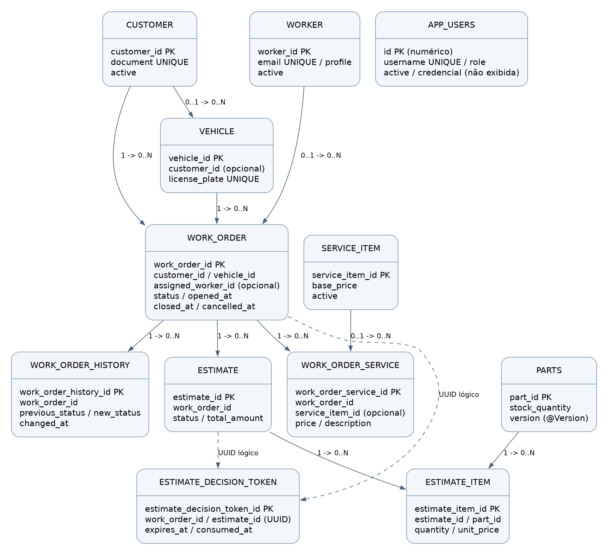

# Banco de dados e modelo relacional

## Justificativa formal do PostgreSQL gerenciado

A Oficina mantém relações fortes entre cliente, veículo, OS, orçamento, itens e estoque.
A abertura de OS e a reserva/devolução de peças exigem transações e integridade entre
entidades. PostgreSQL fornece transações ACID, chaves/constraints e consultas relacionais
compatíveis com Hibernate Reactive/Panache, JDBC/Flyway e o driver pgx da Lambda.
RDS delega operação do mecanismo e backups configurados ao serviço gerenciado.

Alternativas consideradas: MySQL gerenciado também atende relações/transações, mas exigiria
adaptar tipos, drivers e migrations sem benefício medido para este projeto. Um banco NoSQL
exigiria redesenhar as consultas e a consistência entre agregados. Não foi realizado benchmark
comparativo; a escolha é de adequação funcional e continuidade da stack, não superioridade de desempenho.

## Modelo implementado

| Tabela | Identidade e relacionamentos essenciais |
|---|---|
| customer | UUID; documento único; active controla elegibilidade no login CPF |
| vehicle | UUID; placa única; associação a customer (nullable no mapeamento atual) |
| worker | UUID; perfil, email único, password_hash e active |
| work_order | UUID; cliente e veículo obrigatórios; funcionário opcional; status e datas do ciclo |
| work_order_history | UUID; OS obrigatória; status anterior/novo e instante da transição |
| estimate | UUID; OS obrigatória; status e valores de peças/mão de obra/total |
| estimate_item | UUID; orçamento e peça obrigatórios; quantidade, preço e total |
| parts | UUID; quantidade de estoque, mínimo e @Version para concorrência otimista |
| service_item | UUID; catálogo, preço base, duração estimada e active |
| work_order_service | UUID; OS obrigatória; catálogo opcional; descrição/preço registrados |
| estimate_decision_token | UUID atribuído pelo domínio; IDs de OS/orçamento, decisão e validade/consumo |
| app_users | Identificador numérico; username único, credencial, role e active; entidade de autenticação separada |

As relações JPA @ManyToOne são relações mapeadas, sujeitas ao DDL efetivamente aplicado.
`estimate_decision_token.work_order_id/estimate_id` são campos UUID, não associações JPA:
o diagrama usa linhas tracejadas para vínculos lógicos e não afirma existência de FKs físicas.
`app_users` possui entidade JPA no código atual; a documentação legada que o chamava de tabela
sem entidade precisa ser substituída por este retrato atualizado. Valores de credenciais e dados
pessoais não integram o diagrama.

## Cardinalidades e consistência

- Cliente pode ter vários veículos/OS; OS pertence a um cliente e veículo.
- Funcionário pode atender várias OS, e sua atribuição é opcional.
- OS possui histórico, serviços e orçamentos. A modelagem não impõe 1:1 entre OS e orçamento.
- Orçamento contém itens que referenciam peças. Valores monetários usam BigDecimal/decimal.
- Serviço realizado pode manter a referência do catálogo ou apenas o retrato de descrição/preço.
- O estoque usa versão otimista. A consistência do fluxo também depende dos casos de uso e transações.
- Há constraints para estados canônicos em work_order/work_order_history; estados históricos
  incompatíveis são tratados pela migration V2, preservando campos legados.

## Evolução do schema e pontos de revisão

V1 cria o schema; V2 ajusta o ciclo da OS e seu histórico; V3 adiciona active em customer.
Flyway migrate-at-start está habilitado, mas Hibernate schema-management.strategy=update
continua configurado fora dos testes. Logo, Flyway ainda não é a única autoridade do DDL.
A revisão não executou DDL nem consultou dados no banco.

A melhoria recomendada é uma baseline completa e migrations explícitas para criação/evolução,
seguida de validate no runtime. Isso exige planejar migração do banco já existente; não foi
aplicado automaticamente. Não se afirma que PK/FK/índices do schema vivo foram inspecionados.

## Performance e indicadores de negócio

Documento único/placa/username/email de funcionário têm unicidade no mapeamento. Consultas
por cliente, fila operacional, datas e histórico precisam de índices avaliados por planos reais
antes de otimizar. Esta documentação não inventa índices nem resultados EXPLAIN.

O endpoint atual de tempo médio calcula abertura->fechamento das OS concluídas. Isso não
entrega volume por dia nem médias separadas de Diagnóstico/Execução/Finalização no Grafana.
Essas agregações devem usar dados persistidos e históricos de transição, definir timezone,
tratamento de cancelamentos/reentrada e semântica de Finalização. Contadores apenas na memória
de um pod não substituem agregação correta com réplicas/reinícios.

Fonte: entidades de [persistência da aplicação](https://github.com/15SOAT-JVGG/oficina-app/tree/homolog/src/main/java/br/com/fiap/postech/soat16/fase1)
e [migrations](https://github.com/15SOAT-JVGG/oficina-app/tree/homolog/src/main/resources/db/migration).
