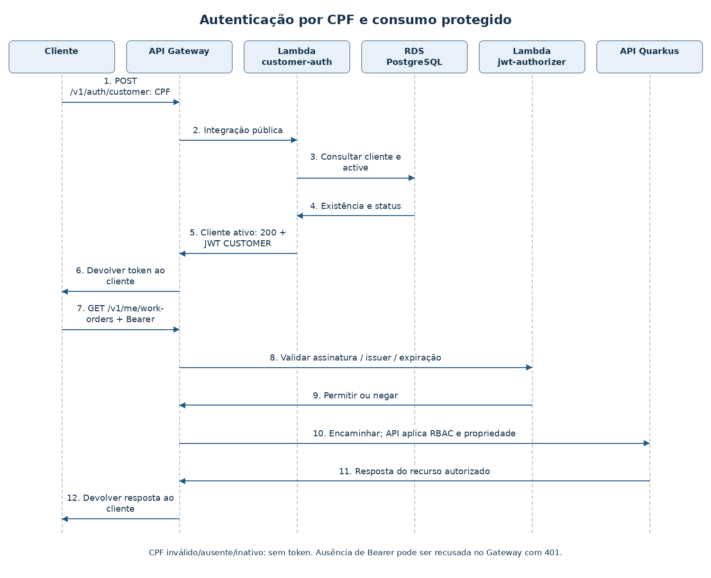
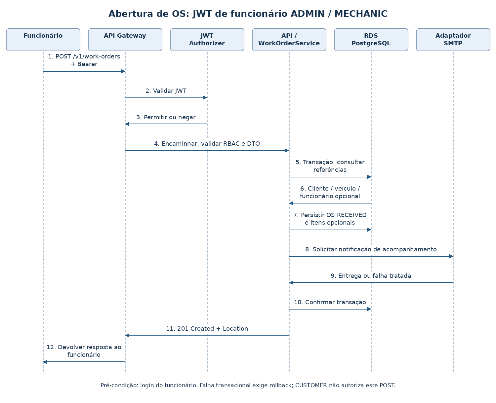

# Sequências dos fluxos obrigatórios

## CPF, emissão de token e consumo protegido

1. O cliente envia o CPF à rota pública POST /v1/auth/customer via TLS.
2. O Gateway integra essa rota com a Lambda customer-auth, sem exigir um token prévio.
3. A função valida o documento e consulta o cliente no PostgreSQL privado.
4. Ausência/inatividade impedem emissão. Com cliente ativo, emite JWT RS256 com issuer,
   expiração, identidade e grupo CUSTOMER. Nenhum valor de CPF/JWT deve aparecer no vídeo.
5. Ao chamar GET /v1/me/work-orders, o cliente envia Authorization Bearer.
6. O Gateway pode rejeitar ausência de identidade com 401 sem invocar a função. Com
   identidade presente, a Lambda Authorizer valida o token e responde permitir/negar.
7. A aplicação valida o contexto de segurança e o vínculo do recurso ao cliente.

O Authorizer não consulta o banco a cada requisição. Desativação de cliente não equivale a
revogação instantânea de tokens já emitidos. O cache do Authorizer está em zero, mas isso
não altera a validade criptográfica/temporal do JWT.

## Abertura da ordem de serviço

Pré-condição: funcionário autenticado com papel ADMIN ou MECHANIC. O login de funcionário
é POST /v1/auth/login na aplicação. O JWT CUSTOMER do fluxo anterior não autoriza este POST.

1. O funcionário envia POST /v1/work-orders com Bearer e referências de cliente/veículo.
2. O Gateway invoca o Authorizer; token recusado encerra o fluxo sem executar o caso de uso.
3. A aplicação aplica RBAC e valida o DTO. Identidade aceita pelo Gateway não substitui RBAC.
4. WorkOrderService.create executa com @WithTransaction. Consulta cliente/veículo e o
   funcionário atribuído quando fornecido, e abre a OS em RECEIVED.
5. Quando existem serviços/peças iniciais, resolve catálogo, cria linhas/orçamento e
   registra a evolução correspondente. Sem solicitação inicial, a OS não cria orçamento.
6. O adaptador de notificação prepara o acompanhamento via SMTP. Falhas de entrega são
   tratadas pelo adaptador; não há Lambda de notificações implantada nesta arquitetura.
7. A transação é confirmada antes de a resposta HTTP 201 ser observada pelo cliente,
   incluindo Location. Falhas transacionais não devem produzir uma OS parcial.

A chamada de notificação ocorre no fluxo reativo do caso de uso; este diagrama não promete
padrão outbox, fila, entrega exatamente uma vez nem commit anterior ao envio SMTP.

## Diagramas editáveis

Os arquivos `.mmd` correspondentes incluem os caminhos alternativos de erro e são renderizáveis
no GitHub/Mermaid. As imagens exportadas destacam o caminho de sucesso e as recusas essenciais.

Fonte: [WorkOrderController](https://github.com/15SOAT-JVGG/oficina-app/blob/homolog/src/main/java/br/com/fiap/postech/soat16/fase1/workorder/adapter/in/rest/controller/WorkOrderController.java),
[WorkOrderService](https://github.com/15SOAT-JVGG/oficina-app/blob/homolog/src/main/java/br/com/fiap/postech/soat16/fase1/workorder/application/WorkOrderService.java)
e [handler CPF](https://github.com/15SOAT-JVGG/oficina-lambda-auth/blob/homolog/internal/handler/handler.go).
